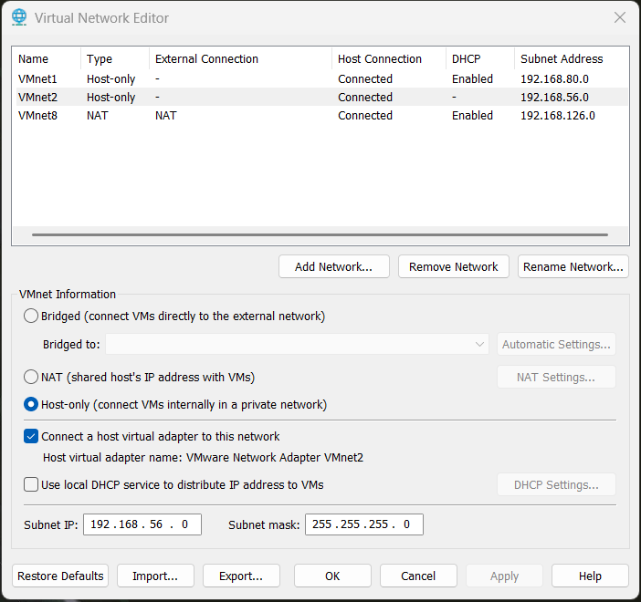
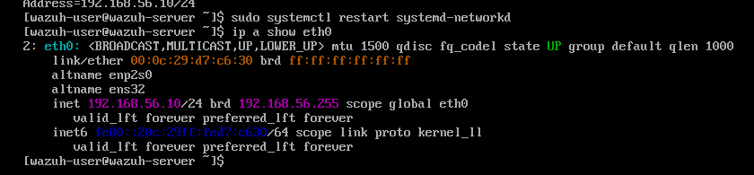
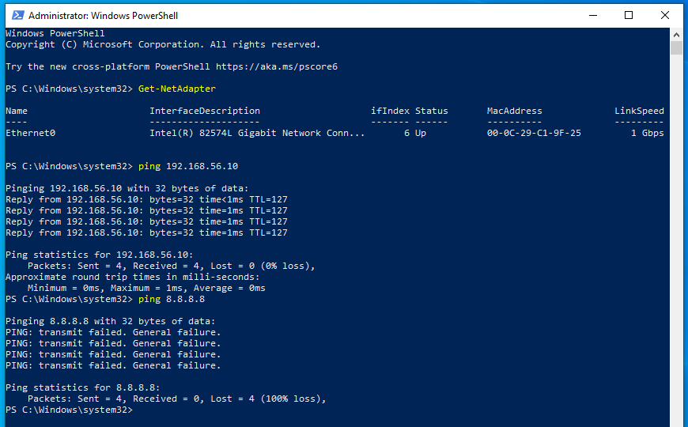
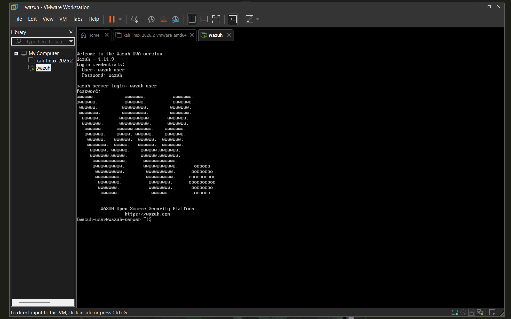

# 01 · Setup: hypervisor, network, and VMs

## Status

- [x] Free disk space confirmed (~100 GB on C:)
- [x] VMware Workstation Pro 17 installed
- [x] Isolated host-only network created (`VMnet2`, `192.168.56.0/24`, DHCP off)
- [x] Kali VM imported (official VMware pre-built image, 2026.2)
- [x] Wazuh server imported (OVA 4.14.9), boots to login, `clean-import` snapshot taken
- [x] Windows 10 21H1 ISO downloaded (5.7 GB)
- [x] Windows victim VM created (Windows 10 21H1, `win-victim`)
- [x] Static IP on Wazuh (`192.168.56.10`), persistent via systemd-networkd
- [x] Static IP on Windows victim (`192.168.56.20`), reaches Wazuh over VMnet2
- [ ] Static IP on Kali (`192.168.56.30`)
- [x] Installers brought into the victim offline (copied to `C:\lab`), so no NAT adapter was needed and the victim stays isolated
- [x] Wazuh agent installed on the victim (`WazuhSvc` shows Running)
- [x] Agent shows **Active** in the Wazuh dashboard (2026-10-22)
- [x] Sysmon installed and verified (`Sysmon64` Running)
- [ ] `clean-install` snapshot of Kali and the Windows victim

## Host

| | |
|---|---|
| Machine | MSI Crosshair 15 (i7-11800H, 8C/16T) |
| RAM | 20 GB (about 9 GB in use at idle, so VMs are booted one at a time at first) |
| OS | Windows 11 Pro, virtualization-based security on |
| Hypervisor | VMware Workstation Pro 17 |
| VM storage | `C:\VMs` (not under OneDrive, so VM disks are not synced) |

## Network design

All lab traffic stays on `VMnet2`, a host-only network with no route to the home network or the internet.



| Setting | Value |
|---|---|
| Network | `VMnet2` |
| Type | Host-only |
| Subnet | `192.168.56.0` / `255.255.255.0` |
| Local DHCP | Off (fixed IPs) |
| Host virtual adapter | Connected (so the Wazuh dashboard opens from the host browser) |

Planned addresses:

| VM | IP (static) | Adapter |
|---|---|---|
| Wazuh | `192.168.56.10` | VMnet2 |
| Windows victim | `192.168.56.20` | VMnet2 only (installers copied in offline) |
| Kali | `192.168.56.30` | VMnet2 |

## Verified connectivity

Wazuh keeps its address across restarts of the network service because it is set in a systemd-networkd file, not just with `ip addr add`:

```ini
# /etc/systemd/network/10-lab.network
[Match]
Name=eth0

[Network]
Address=192.168.56.10/24
```



The Windows victim has one adapter on VMnet2 with `192.168.56.20/24` and no gateway. It reaches Wazuh (4/4 replies) and cannot reach the internet (`8.8.8.8` fails), which confirms it is isolated.



## VM sizing

| VM | RAM | vCPU | Disk |
|---|---|---|---|
| Wazuh | 4 GB | 2 | 50 GB (grows as used) |
| Windows 10 victim | 4 GB | 2 | 50 GB (grows as used) |
| Kali | 2 GB | 2 | pre-built image |

## Wazuh first boot

The OVA boots to its login prompt (`wazuh-server`, version 4.14.9) on `VMnet2`.



## Notes and issues

- **Third-party ISO rejected.** A "Windows 10 Lite Edition" ISO was the first candidate. Repackaged "Lite" images usually strip Defender, Windows Update and telemetry, which are the log sources a SOC lab needs, and their contents can't be verified. Replaced with a standard `Win10_21H1_English_x64.iso`.
- **"is not a virtual machine configuration file (.vmx)".** VMware shows this when you try to open an ISO with **File → Open**. An ISO is not opened that way: use **Create a New Virtual Machine → Installer disc image file** instead.
- **Windows adapter name.** With a single adapter the interface is `Ethernet0`, not `Ethernet1`. `New-NetIPAddress -InterfaceAlias "Ethernet1"` failed with "Invalid parameter" until the real name was found with `Get-NetAdapter`.
- **First pings failed with "General failure".** The new static address was still `Tentative` (duplicate address detection). It cleared after a few seconds.
- **Ping TTL.** Replies from Wazuh show TTL=127 rather than Linux's usual 64. The Windows victim has no other route, so the replies come straight from Wazuh over VMnet2.
- **Typing in the Wazuh console.** The VM console cannot paste, so the config heredoc was first mistyped (`/ete/` instead of `/etc/`, then a wrong service name) and the file was never written. It worked when retyped carefully. For longer configs, SSH in from the host (`ssh wazuh-user@192.168.56.10`) where pasting works.
- **No internet on the victim.** Adding a NAT adapter did not work in this setup, so Sysmon and the Wazuh agent were installed offline from files downloaded on the host. This also keeps the victim fully isolated, which is the intent for the attack phase.
- **Agent installed without a manager address.** The MSI was run without `WAZUH_MANAGER`, so the agent showed `0.0.0.0` and "Auth key not imported". Fixed by setting `<address>192.168.56.10</address>` in `ossec.conf` and enrolling manually with `agent-auth.exe -m 192.168.56.10 -A win-victim`.
- **Wazuh services would not start (`agent-auth` error 1208).** Ping worked but ports 1515 and 443 were closed because `wazuh-indexer`, `wazuh-manager` and `wazuh-dashboard` were down. Starting the indexer failed with "a timeout was exceeded". The indexer simply takes several minutes to start on a 4 GB VM (its JVM heap was auto-sized to about 3.2 GB). Fix: a systemd drop-in with `TimeoutStartSec=900` for the indexer and manager, `systemctl enable` for all three services, then a reboot. After that the stack came up on its own, after several minutes.
- **Dashboard needs patience after boot.** Port 443 only opens once the indexer is ready, so wait 8-10 minutes after powering on before opening `https://192.168.56.10`.
- **Keep VMs out of OneDrive.** Moved the `VMs` folder from the Desktop (OneDrive-backed) to `C:\VMs` before importing anything.
- **Don't store VMs on `D:`.** It is a removable USB drive, which is too slow for VM disks.

## Next

Confirm the agent is Active in the Wazuh dashboard, confirm Sysmon is running, forward the Sysmon channel to Wazuh, then give Kali its static IP. See [`../02-logging/`](../02-logging/).
