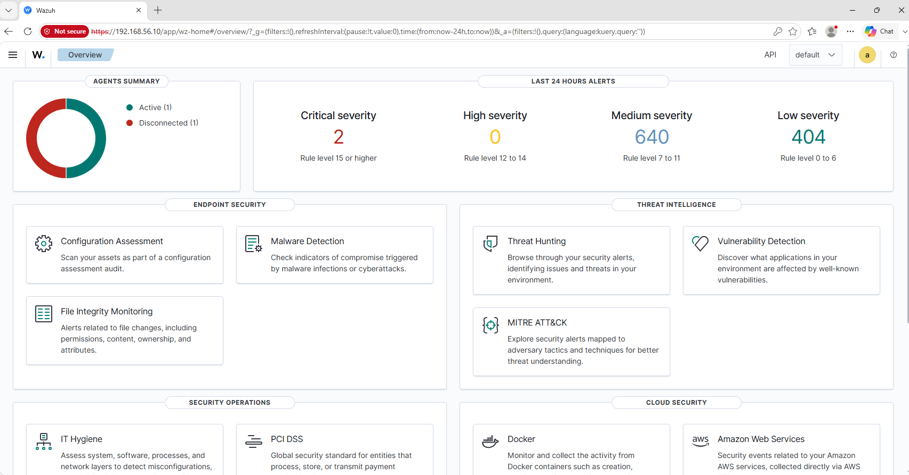
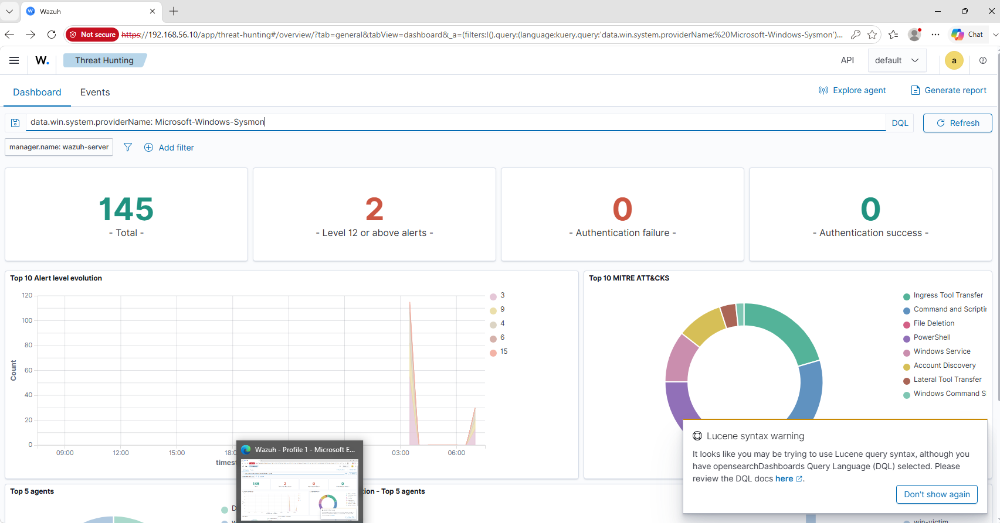
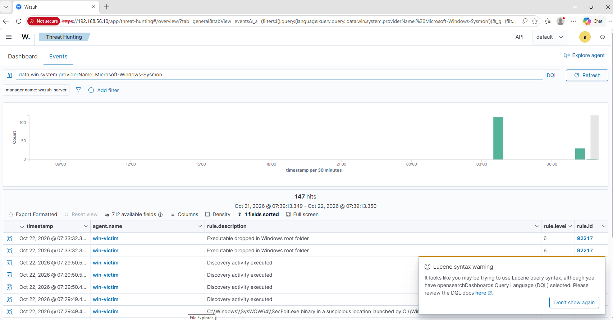

# 02 · Logging

Goal: the SIEM receives logins, process creations, and network events from both endpoints.

## Windows victim

1. Install **Sysmon** with a community config (see `../scripts/install-sysmon.ps1`).
2. Install the **Wazuh agent** and point it at the SIEM (see `../scripts/install-wazuh-agent.ps1`). The agent version must match the server: this lab runs **4.14.9**, so use `-Version 4.14.9`.
3. Make the agent forward the Sysmon channel (see `ossec-sysmon-snippet.xml`).

### Offline install (used in this lab)

The victim is isolated and has no internet, so the installers were downloaded on the host and copied into the VM at `C:\lab`:

```powershell
Expand-Archive C:\lab\Sysmon.zip C:\lab\Sysmon -Force
C:\lab\Sysmon\Sysmon64.exe -accepteula -i C:\lab\sysmonconfig-export.xml
Get-Service Sysmon64

msiexec.exe /i C:\lab\wazuh-agent-4.14.9-1.msi /q WAZUH_MANAGER="192.168.56.10" WAZUH_AGENT_NAME="win-victim"
NET START WazuhSvc
Get-Service WazuhSvc
```

### Status (2026-10-22)

- [x] Wazuh agent installed, `WazuhSvc` Running
- [x] Sysmon running (`Get-Service Sysmon64`)
- [x] Sysmon channel forwarded (snippet added to `ossec.conf`, agent restarted)
- [x] Victim shows **Active** in the Wazuh dashboard



## Linux (Kali)

- Make sure `auth.log` / `journald` is being written.
- Install the Wazuh agent for Linux and register it.

## Verification checklist

- [x] Agent shows **Active** in the Wazuh dashboard
- [x] Sysmon events appear in Wazuh (query `data.win.system.providerName: Microsoft-Windows-Sysmon`, 147 hits in the first 24 h)

  

  

  Early baseline noise (rules 92031, 92066, 92201, 92217, levels 3-9: discovery activity, `SecEdit.exe`, PowerShell writing scripts to Temp) appears right after the agent starts, before any attack was run. It is most likely the agent's own configuration scans and the lab setup commands, so it is recorded here as a baseline to tune against later.
- [ ] Windows logon events (4624 / 4625) appear
- [ ] Linux SSH login events appear

## Notes and screenshots

Save evidence to `../screenshots/02-logging/`.
