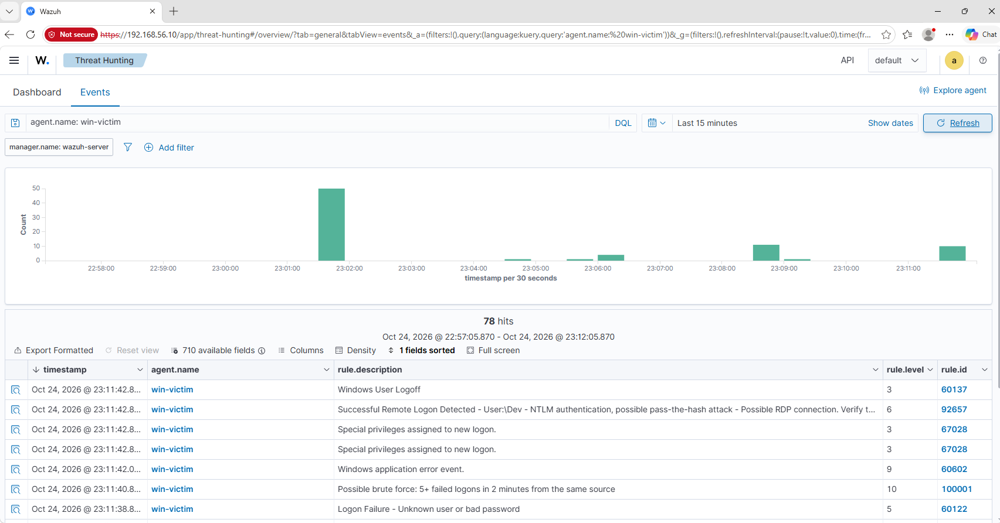

# 04 · Detection rules

Custom Wazuh rules live in `local_rules.xml` (on the server: `/var/ossec/etc/rules/local_rules.xml`).

| Rule ID | Detects | MITRE | Tested against | Status |
|---|---|---|---|---|
| 100001 | 5+ failed Windows logons from the same source in 2 minutes (brute force) | T1110 | [03-attack-simulations/02](../03-attack-simulations/02-rdp-brute-force.md) | ✅ deployed, fired correctly |

## Workflow

1. Run the attack and note the events produced.
2. Find the matching log fields in Wazuh (`Discover` / `wazuh-archives`).
3. Write the rule, restart `wazuh-manager`, replay the attack.
4. Record false positives and tune.

## Rule 100001 — deployed and verified (2026-10-24)

`local_rules.xml` was copied to `/var/ossec/etc/rules/local_rules.xml` on the Wazuh server and `wazuh-manager` was restarted to load it. The RDP brute force from [attack 02](../03-attack-simulations/02-rdp-brute-force.md) was replayed, and the rule fired correctly:

```
rule.id: 100001 — level 10 — "Possible brute force: 5+ failed logons in 2 minutes from the same source"
```

It fired **before** Wazuh's default rule `92657` (the successful-logon alert), since it only needs the fifth failed attempt, not a successful one afterward. That's the actual value of the custom rule: a defender gets warned during the attempt, not only after it (potentially) succeeds.



**Tuning note:** at `frequency=5, timeframe=120` this is tuned to this lab's attack speed (`hydra -t 1 -W 1`, one attempt roughly every 1-2 seconds). A real attacker using a faster, unthrottled tool would trip this rule even sooner; a slower, deliberately-evasive attacker (one guess every few minutes, to stay under typical thresholds) would not — a known, realistic limitation of frequency-based rules, and a reason SOCs also watch for low-and-slow patterns over longer windows.
